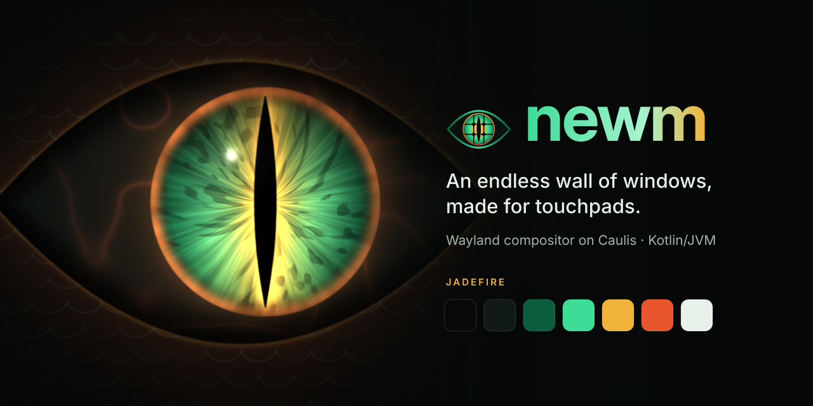
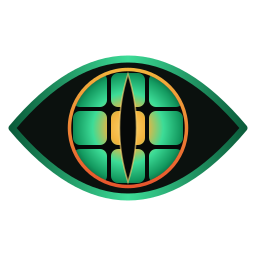

<div align="center">



#  newm

**An endless wall of windows, made for touchpads.**

**English** · [Русский](README.ru.md)

[](LICENSE)
[](https://wayland.freedesktop.org/)
[](https://github.com/AristarkhKenebas/caulis)
[](docs/en/brand.md)


</div>

newm is a Wayland compositor. Most window managers squeeze your windows into the screen.
newm lays them out on an endless wall of tiles, and the screen is a window onto that wall.
Three fingers on the touchpad move over it, four fingers zoom in and out. Zoomed out, every
window gets its new size, so it stays usable. Tap Logo alone to see all of them at once.

| The overview | The launcher |
|---|---|
|  |  |

## What it has

- **Touchpad gestures** that follow your fingers: move, zoom, the overview, the launcher.
  Logo + mouse drag moves and resizes windows.
- **The overview**: every window at once; point, click, and you are there.
- **Its own bar**: the clock and calendar, the tray, notifications, Wi-Fi, Bluetooth, sound,
  battery, and quick settings like on a phone. waybar or any other bar works too.
- **Built in**: a lock screen (your password, checked with PAM), a launcher, a clipboard
  history (Logo+V), screenshots (an area, a window, a screen), the keys' help (Logo+/).
- **Your configuration in `config.kts`**, with a note on every setting. Save it and newm
  applies it at once; a mistake shows as a card, and newm keeps what worked. JSON, Lua and
  the old newm's `config.py` work too.
- **Looks**: rounded corners, blur, colours from your wallpaper, light or dark for newm and
  your programs, border gradients and your own border shaders.
- **Animations** in Hyprland's style, each by name. They are off by default;
  `animations { preset = "newm" }` turns on newm's own set.
- **A special workspace** above the wall, and drop-down scratchpads.
- **Autostart and a smooth start**: a black screen until newm is ready, then a fade-in, then
  your programs one after another.
- **X11 programs** through Xwayland, **screen sharing** through the portals.
- **Nix**: a flake with a package, a NixOS module and a home-manager module.

## Quick start

### NixOS

```nix
# flake.nix
inputs.newm.url = "github:AristarkhKenebas/newm";
inputs.newm.inputs.nixpkgs.follows = "nixpkgs";   # optional and safe (never nixpkgs-gradle)

# your NixOS configuration
imports = [ newm.nixosModules.default ];
programs.newm.enable = true;
```

`sudo nixos-rebuild switch`, then choose "newm" in your login screen, or type `newm` on a
text console. More: [NixOS](docs/en/install/nixos.md).

### Any other Linux

1. **Install Java 27** and the libraries newm opens (Mesa, libinput, libseat, ...). Your
   distribution's page below has the exact command. No Java 27 package? Take
   [Temurin's](docs/en/install.md#java-27) and put it in `/usr/lib/jvm`.
2. **Build and install:**

   ```sh
   git clone https://github.com/AristarkhKenebas/newm
   cd newm
   ./install.sh
   ```

   (Or `./gradlew installDist` and run `build/install/newm/bin/newm`.)
3. **Start it**: log in on a text console (Ctrl+Alt+F3) and type `newm`, or choose "newm"
   in your login screen.

The first start writes your configuration to `~/.config/newm/config.kts`. Press **Logo+/**
for every key, **Logo+Return** for a terminal, **Logo+D** for the launcher, and
**Logo+Shift+Escape** to log out.

## Install on your system

| System | Page |
|---|---|
| NixOS | [NixOS](docs/en/install/nixos.md) |
| Arch, EndeavourOS, Manjaro, CachyOS | [Arch](docs/en/install/arch.md) |
| Debian 13+, Ubuntu 24.04+, Mint, Pop!_OS | [Debian and Ubuntu](docs/en/install/debian-ubuntu.md) |
| Fedora, Nobara | [Fedora](docs/en/install/fedora.md) |
| openSUSE Tumbleweed | [openSUSE](docs/en/install/opensuse.md) |
| Void Linux | [Void](docs/en/install/void.md) |
| Gentoo | [Gentoo](docs/en/install/gentoo.md) |
| Alpine (musl, untested) | [Alpine](docs/en/install/alpine.md) |
| Something else | [Other systems](docs/en/install/other.md) |

## Documentation

- [Install](docs/en/install.md): what newm needs, and every system
- [Everyday use](docs/en/using.md): keys, gestures, the overview, screenshots, the clipboard
- [Your configuration](docs/en/configuration.md)
- [Every setting](docs/en/settings.md), and `newm cmd`
- [When something goes wrong](docs/en/troubleshooting.md)
- [All of the documentation](docs/en/README.md)
- [What changed](CHANGELOG.md)

Found a problem? Please [open an issue](https://github.com/AristarkhKenebas/newm/issues)
([what to put in it](docs/en/testing.md#reporting-a-problem)).

## Credits

newm was written in Python by Jonas Bucher ([jbuchermn/newm](https://github.com/jbuchermn/newm)),
on pywm and wlroots, and is no longer maintained there. This newm carries it on: ported to
Kotlin, one to one in how it behaves, and built on the
[Caulis](https://github.com/AristarkhKenebas/caulis) compositor library. The original Python
code is kept in [`legacy/`](legacy) for reference.

## License

MIT, as the original newm. See [LICENSE](LICENSE).
