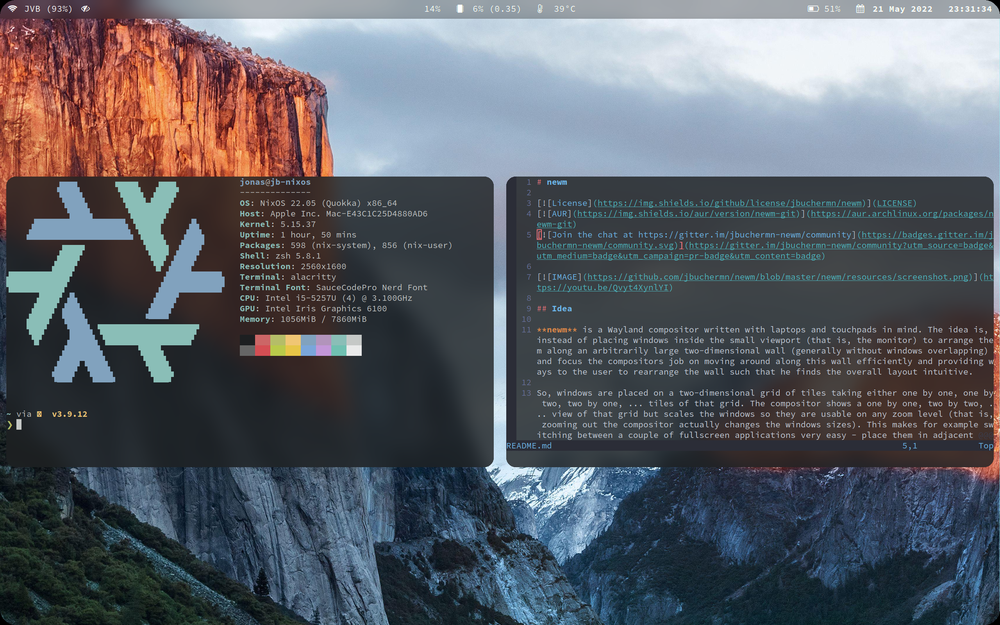

<div align="center">

# newm

**Wayland-композитор для ноутбуков и тачпадов: ваши окна на бесконечной стене.**

[English](README.md) · **Русский**

[](https://youtu.be/4I_IHbP-iNQ)

</div>

Обычные оконные менеджеры втискивают окна в экран. newm раскладывает их по бесконечной
стене из плиток, а экран — это окно на эту стену. Тремя пальцами вы двигаетесь по ней,
четырьмя приближаете и отдаляете. При отдалении окна получают новый размер, так что ими
удобно пользоваться при любом масштабе.

## Что вы получаете

- **Сделан для тачпада.** Движение, масштаб, обзор всех окон и лаунчер — всё жестами, с
  плавной анимацией.
- **Красиво сразу.** Скруглённые окна с гладкими краями, размытие за полупрозрачными
  окнами, свой экран блокировки и лаунчер.
- **Своя панель.** Острова у верхнего края: маленькая карта вашей стены, окно, часы с
  календарём, трей фоновых программ с их меню, сеть, громкость, батарея и меню питания.
  Светлая или тёмная — как ваши программы.
- **Меняйте на ходу.** Сохраните конфигурацию, и newm сразу её применит. Ошибка
  появится карточкой с номером строки, а newm оставит рабочие настройки. Сломанная
  конфигурация никогда не даст чёрный экран.
- **Конфигурация на вашем языке.** Kotlin (`config.kts`, родной для newm), Lua, JSON или
  полностью декларативный Nix. Старый `config.py` от newm тоже работает.
- **Дружит с тем, что у вас уже есть.** waybar или любая другая панель (или никакой),
  mako, swaybg, программы X11, демонстрация экрана через порталы.

## Быстрый старт

Нужны Java 27 и терминал (по умолчанию alacritty).

```sh
git clone https://github.com/AristarkhKenebas/newm
cd newm
./install.sh
```

Затем наберите `newm` в текстовой консоли или выберите «newm» на экране входа. При первом
запуске newm запишет вашу конфигурацию в `~/.config/newm/config.kts`, с пояснением к
каждой настройке.

Первые клавиши:

- **Logo+Return** — терминал;
- **Logo+d** — лаунчер;
- **Logo** отдельно — все окна сразу;
- **Logo+h/j/k/l** — перемещение;
- **Logo+Shift+Escape** — выход из сессии.

## Документация

- [Установка](docs/ru/install.md)
- [Каждый день: клавиши и жесты](docs/ru/using.md)
- [Ваша конфигурация](docs/ru/configuration.md)
- [Все настройки](docs/ru/settings.md)
- [Панели](docs/ru/bars.md)
- [Lua, JSON, Nix и старый config.py](docs/ru/other-formats.md)
- [Если что-то пошло не так](docs/ru/troubleshooting.md)
- [Разработка newm](docs/ru/development.md)

## Об этом newm

newm написал Jonas Bucher на Python поверх pywm ([jbuchermn/newm](https://github.com/jbuchermn/newm)),
и там он больше не поддерживается. Здесь newm продолжается:

- перенесён на Kotlin, один в один по поведению;
- работает на библиотеке композиторов [Caulis](https://github.com/AristarkhKenebas/caulis)
  вместо pywm и wlroots;
- с исправлениями старых проблем newm и новыми частями: панель, экран блокировки,
  лаунчер, перезагрузка конфигурации при сохранении, другие языки конфигурации,
  документация.

Исходный код на Python лежит в [`legacy/`](legacy) для справки.

## Лицензия

MIT, как и у newm. См. [LICENSE](LICENSE).
