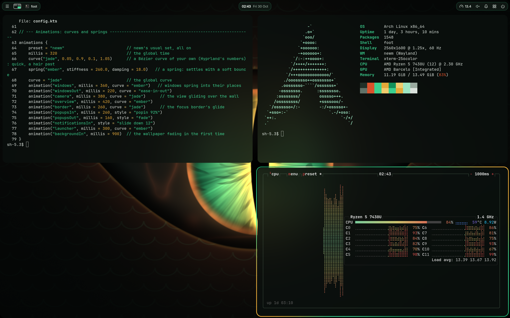
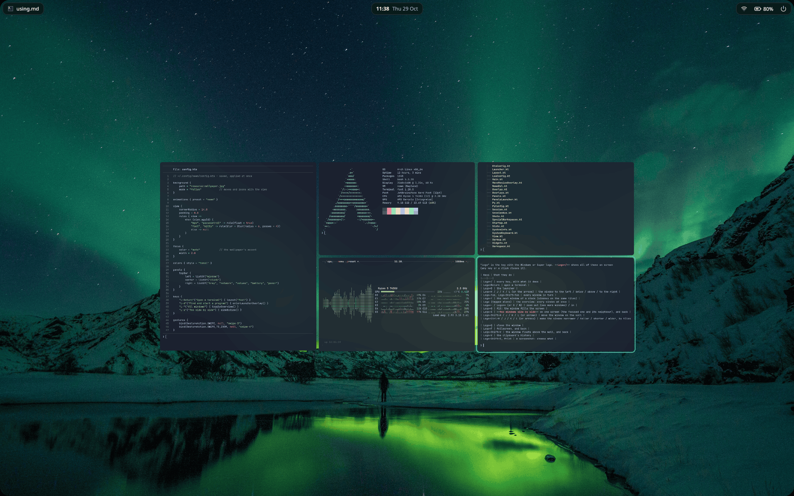
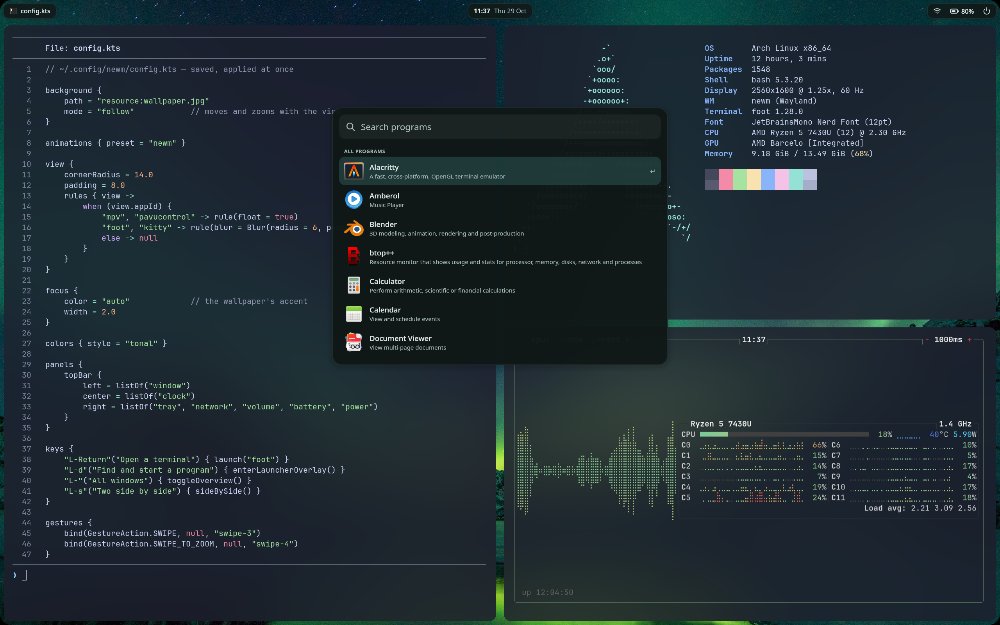

<div align="center">

# newm

**Бесконечная стена из окон, сделанная для тачпада.**

[English](README.md) · **Русский**

[](LICENSE)



</div>

newm — это композитор Wayland. Обычные оконные менеджеры втискивают окна в экран. newm
раскладывает их по бесконечной стене из плиток, а экран — это окно на эту стену. Тремя
пальцами на тачпаде вы двигаетесь по ней, четырьмя приближаете и отдаляете. При отдалении
каждое окно получает новый размер, так что им по-прежнему удобно пользоваться. Нажмите
одну клавишу Logo — и увидите все окна сразу.

| Обзор | Лаунчер |
|---|---|
|  |  |

## Что в нём есть

- **Жесты тачпада**, которые следуют за пальцами: движение, масштаб, обзор, лаунчер.
  Logo + перетаскивание мышью двигает окна и меняет их размер.
- **Обзор**: все окна сразу; наведите, щёлкните — и вы там.
- **Своя панель**: часы и календарь, трей, уведомления, Wi-Fi, Bluetooth, звук, батарея и
  быстрые настройки как на телефоне. waybar или любая другая панель тоже подойдёт.
- **Встроено**: экран блокировки (ваш пароль, проверка через PAM), лаунчер, история буфера
  обмена (Logo+V), снимки экрана (область, окно, экран), подсказка по клавишам (Logo+/).
- **Конфигурация в `config.kts`**, с пояснением к каждой настройке. Сохраните файл — newm
  сразу применит его; ошибка появится карточкой, а newm оставит то, что работало. JSON, Lua и
  `config.py` старого newm тоже работают.
- **Внешний вид**: скруглённые углы, размытие, цвета из ваших обоев, светлая или тёмная тема
  для newm и ваших программ, градиенты рамок и собственные шейдеры рамок.
- **Анимации** в стиле Hyprland, каждая по имени. По умолчанию они выключены;
  `animations { preset = "newm" }` включает набор newm.
- **Особый рабочий стол** поверх стены и выпадающие окна (scratchpad).
- **Автозапуск и плавный старт**: чёрный экран, пока newm не готов, затем плавное появление,
  затем ваши программы одна за другой.
- **Программы X11** через Xwayland, **демонстрация экрана** через порталы.
- **Nix**: flake с пакетом, модулем NixOS и модулем home-manager.

## Быстрый старт

### NixOS

```nix
# flake.nix
inputs.newm.url = "github:AristarkhKenebas/newm";
inputs.newm.inputs.nixpkgs.follows = "nixpkgs";   # по желанию, безопасно (но не nixpkgs-gradle)

# ваша конфигурация NixOS
imports = [ newm.nixosModules.default ];
programs.newm.enable = true;
```

`sudo nixos-rebuild switch`, затем выберите «newm» на экране входа или наберите `newm` в
текстовой консоли. Подробнее: [NixOS](docs/ru/install/nixos.md).

### Любой другой Linux

1. **Установите Java 27** и библиотеки, которые открывает newm (Mesa, libinput, libseat, ...).
   Точная команда — на странице вашего дистрибутива ниже. Нет пакета Java 27? Возьмите
   [Temurin](docs/ru/install.md#java-27) и положите его в `/usr/lib/jvm`.
2. **Соберите и установите:**

   ```sh
   git clone https://github.com/AristarkhKenebas/newm
   cd newm
   ./install.sh
   ```

   (Или `./gradlew installDist` и запуск `build/install/newm/bin/newm`.)
3. **Запустите**: войдите в текстовой консоли (Ctrl+Alt+F3) и наберите `newm` или выберите
   «newm» на экране входа.

Первый запуск запишет вашу конфигурацию в `~/.config/newm/config.kts`. **Logo+/** покажет все
клавиши, **Logo+Return** откроет терминал, **Logo+D** — лаунчер, **Logo+Shift+Escape** —
выход из сеанса.

## Установка в вашей системе

| Система | Страница |
|---|---|
| NixOS | [NixOS](docs/ru/install/nixos.md) |
| Arch, EndeavourOS, Manjaro, CachyOS | [Arch](docs/ru/install/arch.md) |
| Debian 13+, Ubuntu 24.04+, Mint, Pop!_OS | [Debian и Ubuntu](docs/ru/install/debian-ubuntu.md) |
| Fedora, Nobara | [Fedora](docs/ru/install/fedora.md) |
| openSUSE Tumbleweed | [openSUSE](docs/ru/install/opensuse.md) |
| Void Linux | [Void](docs/ru/install/void.md) |
| Gentoo | [Gentoo](docs/ru/install/gentoo.md) |
| Alpine (musl, не проверено) | [Alpine](docs/ru/install/alpine.md) |
| Что-то другое | [Другие системы](docs/ru/install/other.md) |

## Документация

- [Установка](docs/ru/install.md): что нужно newm, и все системы
- [Каждый день](docs/ru/using.md): клавиши, жесты, обзор, снимки экрана, буфер обмена
- [Ваша конфигурация](docs/ru/configuration.md)
- [Все настройки](docs/ru/settings.md) и `newm cmd`
- [Если что-то пошло не так](docs/ru/troubleshooting.md)
- [Вся документация](docs/ru/README.md)
- [Что изменилось](CHANGELOG.md) (на английском)

Нашли проблему? Пожалуйста, [создайте issue](https://github.com/AristarkhKenebas/newm/issues)
([что в него написать](docs/ru/testing.md#как-сообщить-о-проблеме)).

## Благодарности

newm написал на Python Йонас Бухер ([jbuchermn/newm](https://github.com/jbuchermn/newm)),
на pywm и wlroots; там он больше не поддерживается. Этот newm продолжает его: перенесён на
Kotlin один в один по поведению и построен на библиотеке композиторов
[Caulis](https://github.com/AristarkhKenebas/caulis). Исходный код на Python лежит в
[`legacy/`](legacy) для справки.

## Лицензия

MIT, как у исходного newm. См. [LICENSE](LICENSE).
