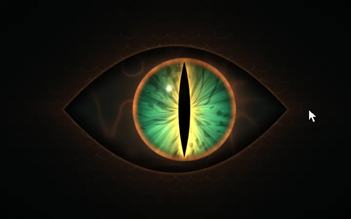
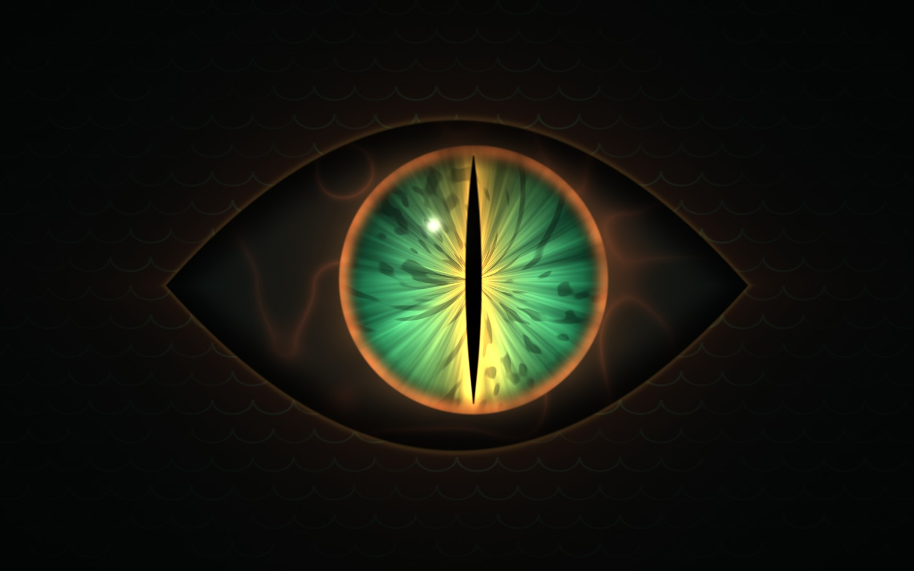
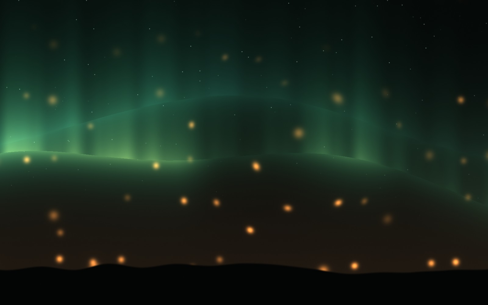
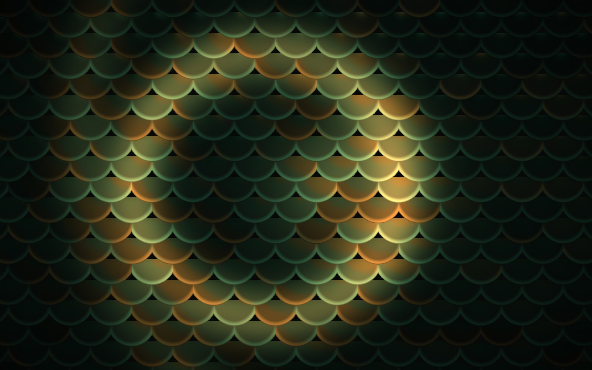
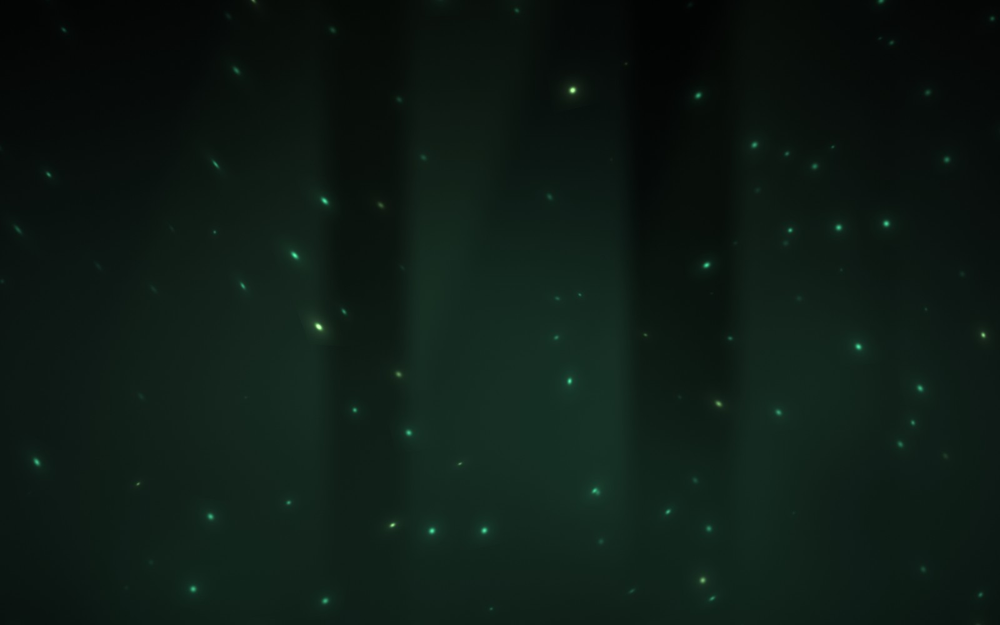
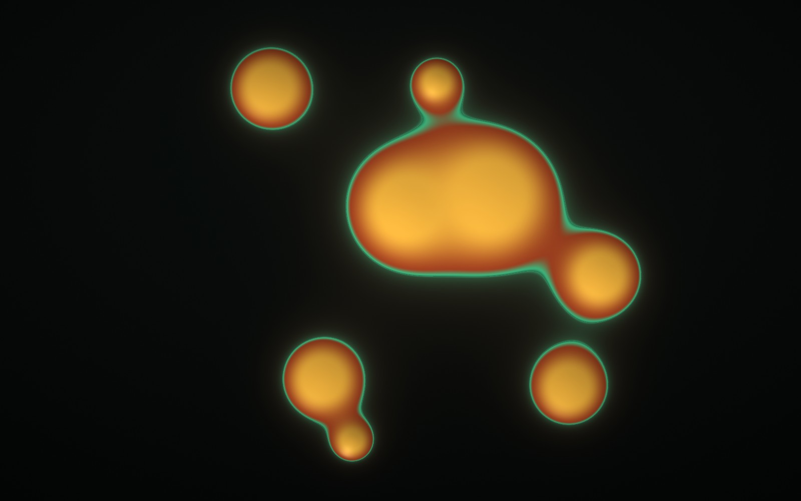

# Конфигурация-витрина

`templates/showcase/config.kts` — newm, где всё настроено по максимуму, в его собственном
[облике Jadefire](brand.md): живая отправная точка, чтобы скопировать и подогнать под себя.
newm кладёт её в `~/.config/newm/showcase/config.kts` при первом запуске (с русскими заметками в
русской системе). Чтобы её включить, сохраните свою конфигурацию и поставьте эту на её место:

```sh
cd ~/.config/newm
mv config.kts config.kts.bak
cp showcase/config.kts config.kts
```

После сохранения она сразу применяется. У каждой строки есть заметка: что она делает и чем ещё
может быть.


## Что она включает

- **`theme = "jadefire"`**: нефрит и янтарь на почти чёрном зелёном — острова панели, её меню,
  карточки уведомлений, экран блокировки и лаунчер в одних цветах.
- **Обои, которые следят за вами**: `background { shader = "dragon-eye" }` — дышащая радужка,
  чей зрачок-щель следует за указателем и сужается, когда тот движется быстро. Они двигаются и
  масштабируются с видом, как картинка, рисуются 30 раз в секунду, только пока их видно (15 от
  батареи), и замирают через две минуты без ввода.
- **Светящаяся рамка фокуса**: шейдер `"jadefire"`, нефрит перетекает в янтарь, по кругу бежит
  искра; срочное окно пульсирует углями.
- **Анимации с кривыми и пружинами**: своя кривая Безье (`curve("jade", ...)`), пружина
  (`spring("ember", ...)`), окна пружинят на места, вид скользит, меню всплывают.
- **Размытие и скругления**: прозрачные терминалы с размытым фоном, скруглённые окна и углы
  экрана, окна без фокуса чуть прозрачны.
- **Особое рабочее место для музыки**: проигрыватель открывается скрытым над стеной; Super+M
  показывает его над притушенной размытой стеной (Super+Ctrl+M ещё и запускает его — код на
  Kotlin в клавише).
- **Экраны** по два окна, раскладки перебираются по Super+Space.
- **Панель полнее**: кнопка лаунчера, маленькая карта стены, окно, часы и свой модуль (загрузка
  процессора; щелчок открывает btop).
- **Красивый старт**: темно, пока newm не готов, медленное появление, звук; программы,
  запускаемые с сессией (`autostart { }`).

| Обзор (одна Logo) | Лаунчер (Super+D) |
|---|---|
|  |  |

## Обои

Поменяйте `shader` на любые другие обои newm или на свой файл `.glsl` рядом с конфигурацией
(перечитывается при сохранении). Все откликаются на указатель; `speed`, `intensity`,
`shaderValues` и `shaderColors` их настраивают.



| `dragon-eye` | `ember-sky` |
|---|---|
|  |  |
| **`scales`** — рябь от щелчков | **`deep-forest`** |
|  |  |
| **`molten`** | |
|  | |

Они обходятся недорого: при 30 кадрах в секунду экран 1080p занимает встроенную видеокарту
(AMD Renoir) на несколько процентов, а экран больше 2560×1600 сам рисует их вдвое меньшими по
каждой стороне (`resolution`). Под полноэкранным окном, на экране блокировки и после `pauseAfter`
секунд без ввода для них не рисуется ничего.

## Под себя

Заметки в файле говорят, чем может быть каждая строка. Первые шаги:

- обои спокойнее: `shader = "deep-forest"`; неподвижные: `fps = 1` или картинка (`path`);
- свои цвета поверх облика: `focus { color = "rgba(3ddc97ff) rgba(f2b33dff) 45deg" }`,
  `colors { source = "wallpaper" }`;
- меньше анимаций: `animations { preset = "none" }`;
- свободная стена вместо экранов: `screens { enabled = false }`.

Все настройки: [settings.md](settings.md).
